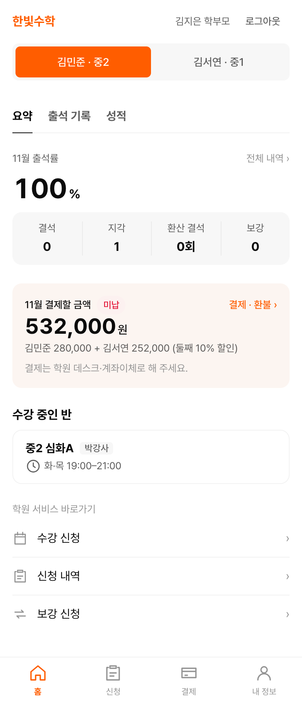
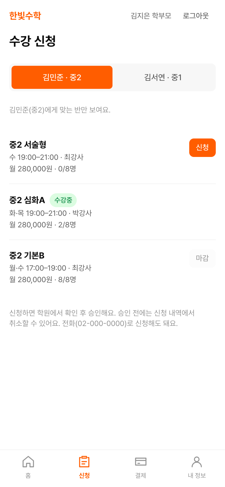
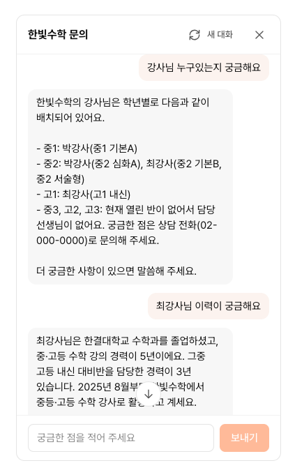

# 한빛수학 코어 웹

수학학원 "한빛수학"의 학부모·학생용 웹이에요. 학부모는 수강 신청부터 보강·환불 신청까지 직접 처리하고, 학생은 자기 일정과 출석, 성적을 확인해요.

학부모 화면은 하단 탭 중심의 모바일 화면으로 만들었어요. AX Campus 3회차 과제로 만든 서비스이고, 학원과 사람, 숫자는 모두 가상이에요.

## 관련 링크

| 구분 | 서비스 | GitHub 저장소 |
|---|---|---|
| 코어 웹 | [웹사이트 열기](https://academy-enrollment-web.vercel.app) | [academy-enrollment-web](https://github.com/jexists/academy-enrollment-web) (현재 저장소) |
| 어드민 | [웹사이트 열기](https://academy-enrollment-admin.vercel.app) | [academy-enrollment-admin](https://github.com/jexists/academy-enrollment-admin) |
| 백엔드 API | [서버 상태 보기](https://academy-enrollment-backend.onrender.com/health) | [academy-enrollment-backend](https://github.com/jexists/academy-enrollment-backend) |

**발표 자료**: [HTML 슬라이드 27장 보기](https://jexists.github.io/academy-enrollment-web/)

## 기술 스택

**Frontend**

<table>
  <tr>
    <td align="center" width="96"><picture><source media="(prefers-color-scheme: dark)" srcset="https://cdn.simpleicons.org/nextdotjs/ffffff"></picture><br><sub>Next.js</sub></td>
    <td align="center" width="96"><br><sub>React</sub></td>
    <td align="center" width="96"><br><sub>TypeScript</sub></td>
    <td align="center" width="96"><br><sub>Tailwind CSS</sub></td>
  </tr>
</table>

**Deployment**

<table>
  <tr>
    <td align="center" width="96"><picture><source media="(prefers-color-scheme: dark)" srcset="https://cdn.simpleicons.org/vercel/ffffff"></picture><br><sub>Vercel</sub></td>
  </tr>
</table>

## 주요 기능

- **공개 안내**: 반 목록과 남은 자리, 강사 소개, 학원 안내 문서를 로그인 없이 볼 수 있어요.
- **자녀 요약**: 학부모 홈에서 자녀별 출석률, 보강, 이번 달 결제할 금액을 한눈에 봐요.
- **수강 신청**: 자녀 학년에 맞는 반만 보여 주고, 신청할 수 없는 반은 이유와 함께 비활성으로 표시해요.
- **보강·환불 신청**: 조건에 맞는 보강 수업을 신청하고, 환불은 예상 금액을 확인한 뒤 요청해요.
- **학생 화면**: 학생은 내 스케줄, 출석 기록, 성적을 보기만 할 수 있어요.
- **문의 챗봇**: 학원 안내 문서를 바탕으로 답하고, 답변은 글자가 이어지는 방식으로 나와요.

## 대표 화면

<table>
  <tr>
    <td align="center"></td>
    <td align="center"></td>
    <td align="center"></td>
  </tr>
  <tr>
    <td align="center"><sub>자녀 요약</sub></td>
    <td align="center"><sub>수강 신청</sub></td>
    <td align="center"><sub>문의 챗봇</sub></td>
  </tr>
</table>

## 프로젝트 구조

```text
src/
├── app/          # 경로별 페이지
├── features/     # 업무별 화면과 로직 (parent, student, chat 등)
├── components/   # 공용 UI와 레이아웃
└── lib/          # API 호출, 로그인, 형식 변환
content/guide/    # 학원 안내 문서 10개
docs/             # 발표 자료와 화면 캡처 (GitHub Pages)
```

## 문서

- [학원 안내 문서](content/guide/)
- [발표 자료 원본](docs/index.html)
- [API와 DB 구조](https://github.com/jexists/academy-enrollment-backend#readme)
